  <picture>
    <source media="(prefers-color-scheme: dark)" srcset="./assets/torine-hero.svg" />
    <source media="(prefers-color-scheme: light)" srcset="./assets/torine-hero-light.svg" />
    
  </picture>

  <a href="https://windy664.github.io/"><picture>
    <source media="(prefers-color-scheme: dark)" srcset="./assets/nav-blog.svg" />
    <source media="(prefers-color-scheme: light)" srcset="./assets/nav-blog-light.svg" />
    
  </picture></a>
  <a href="https://github.com/windy664?tab=repositories"><picture>
    <source media="(prefers-color-scheme: dark)" srcset="./assets/nav-repositories.svg" />
    <source media="(prefers-color-scheme: light)" srcset="./assets/nav-repositories-light.svg" />
    
  </picture></a>
  <a href="https://github.com/windy664?tab=stars"><picture>
    <source media="(prefers-color-scheme: dark)" srcset="./assets/nav-inspiration.svg" />
    <source media="(prefers-color-scheme: light)" srcset="./assets/nav-inspiration-light.svg" />
    
  </picture></a>

  <picture>
    <source media="(prefers-color-scheme: dark) and (max-width: 600px)" srcset="./assets/torine-about-mobile.svg" />
    <source media="(max-width: 600px)" srcset="./assets/torine-about-mobile-light.svg" />
    <source media="(prefers-color-scheme: dark)" srcset="./assets/torine-about.svg" />
    <source media="(prefers-color-scheme: light)" srcset="./assets/torine-about-light.svg" />
    
  </picture>

  <picture>
    <source media="(prefers-color-scheme: dark) and (max-width: 600px)" srcset="./assets/toolbox-mobile.svg" />
    <source media="(max-width: 600px)" srcset="./assets/toolbox-mobile-light.svg" />
    <source media="(prefers-color-scheme: dark)" srcset="./assets/toolbox.svg" />
    <source media="(prefers-color-scheme: light)" srcset="./assets/toolbox-light.svg" />
    
  </picture>

  <a href="https://windy664.github.io/"><picture>
    <source media="(prefers-color-scheme: dark)" srcset="./assets/torine-footer.svg" />
    <source media="(prefers-color-scheme: light)" srcset="./assets/torine-footer-light.svg" />
    
  </picture></a>

