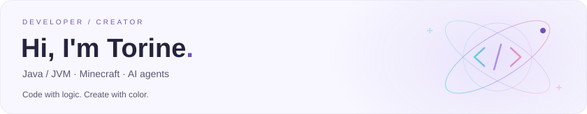

<picture>
  <source media="(prefers-color-scheme: dark)" srcset="./assets/compact-header-dark.svg" />
  
</picture>

  <a href="https://windy664.github.io/"><b>Blog ↗</b></a>&nbsp;&nbsp; · &nbsp;&nbsp;
  <a href="https://github.com/windy664?tab=repositories">Repositories</a>&nbsp;&nbsp; · &nbsp;&nbsp;
  <a href="https://github.com/windy664?tab=stars">Inspiration</a>

**Java at heart. Curious by nature.** 
I build Minecraft plugins, backend systems, and cross-server data sync. 
Exploring AI agents & automation. Off-screen: photography, video editing & design.

**Languages** &nbsp; `Java` `Kotlin` `Python` `Rust` 
**Toolbox** &nbsp;&nbsp;&nbsp; `Maven` `MySQL` `Redis` `Docker` `Git` `Arduino`
