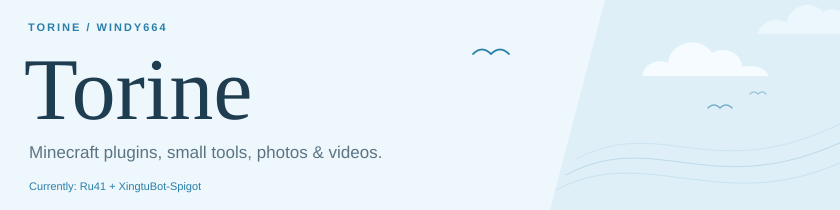
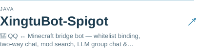
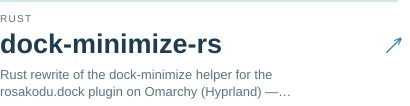
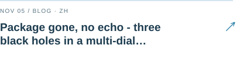
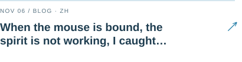

<picture><source media="(prefers-color-scheme: dark)" srcset="https://raw.githubusercontent.com/windy664/windy664/master/assets/compact-header-dark.svg"/></picture>

<a href="https://windy664.github.io/"><picture><source media="(prefers-color-scheme: dark)" srcset="https://raw.githubusercontent.com/windy664/windy664/master/assets/profile-link-blog-dark.svg"/></picture></a><a href="https://github.com/windy664?tab=repositories"><picture><source media="(prefers-color-scheme: dark)" srcset="https://raw.githubusercontent.com/windy664/windy664/master/assets/profile-link-code-dark.svg"/></picture></a><a href="https://windy664.github.io/rss.xml"><picture><source media="(prefers-color-scheme: dark)" srcset="https://raw.githubusercontent.com/windy664/windy664/master/assets/profile-link-rss-dark.svg"/></picture></a>

<picture><source media="(prefers-color-scheme: dark)" srcset="https://skillicons.dev/icons?i=java%2Ckotlin%2Cpython%2Crust%2Cmaven%2Cmysql%2Credis%2Cdocker%2Cgit%2Carduino&amp;theme=dark"/></picture>

<!-- JOURNAL:START -->
<h4>On my desk</h4>

<a href="https://github.com/windy664/Ru41"><picture><source media="(prefers-color-scheme: dark)" srcset="https://raw.githubusercontent.com/windy664/windy664/master/assets/profile-projects-0-dark.svg" /></picture></a>
<a href="https://github.com/windy664/XingtuBot-Spigot"><picture><source media="(prefers-color-scheme: dark)" srcset="https://raw.githubusercontent.com/windy664/windy664/master/assets/profile-projects-1-dark.svg" /></picture></a>

<h4>Recent posts</h4>

<a href="https://windy664.github.io/2026/11/06/2026-11-06-鼠标绑定时灵时不灵-我在hyprlandluafork里抓到了release幽灵/"><picture><source media="(prefers-color-scheme: dark)" srcset="https://raw.githubusercontent.com/windy664/windy664/master/assets/profile-posts-0-dark.svg" /></picture></a>
<a href="https://windy664.github.io/2026/11/05/p-95dde96737f0/"><picture><source media="(prefers-color-scheme: dark)" srcset="https://raw.githubusercontent.com/windy664/windy664/master/assets/profile-posts-1-dark.svg" /></picture></a>

<!-- JOURNAL:END -->

Contribution snake

 
<picture><source media="(prefers-color-scheme: dark)" srcset="https://raw.githubusercontent.com/windy664/windy664/master/assets/contributions-dark.svg"/></picture>

